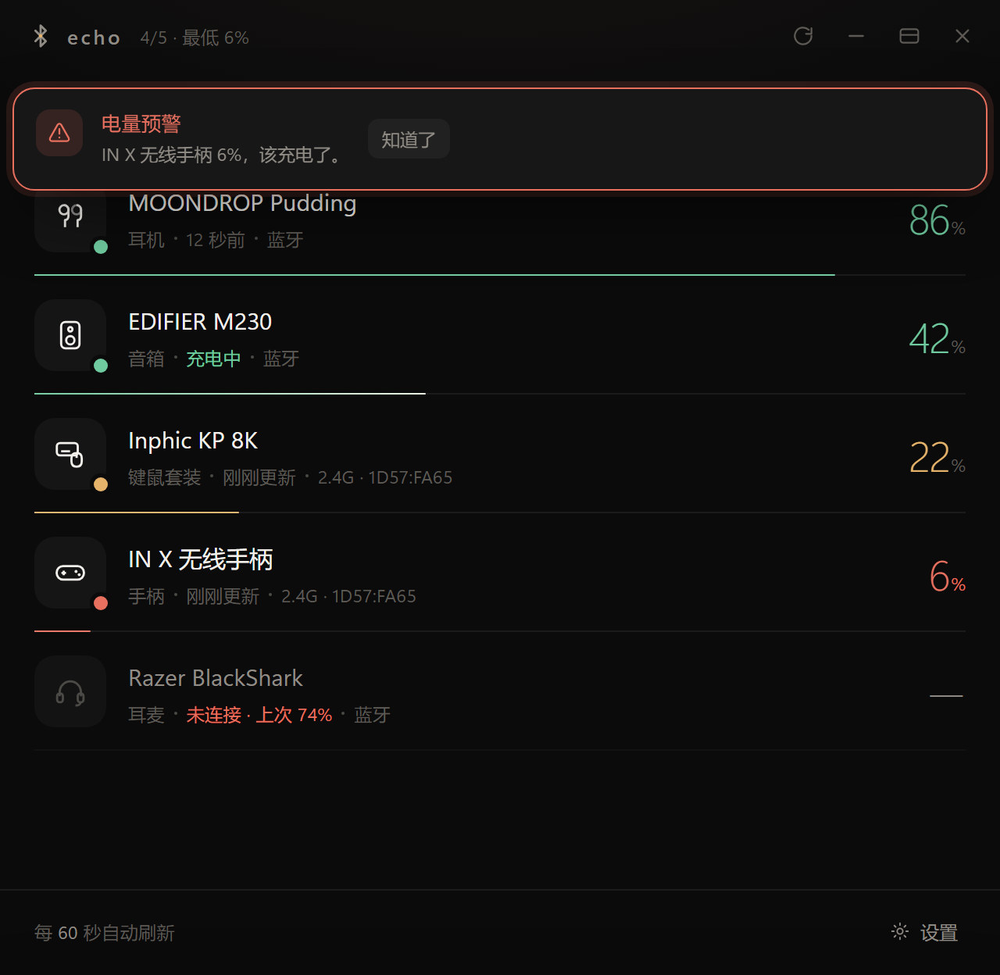
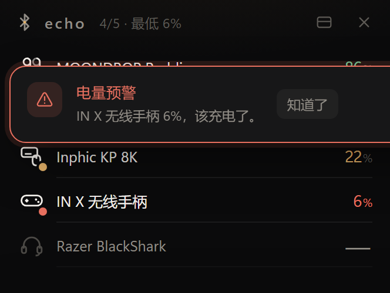

<div align="center">


# Echo

**一屏看清所有无线设备的电量。**

蓝牙耳机、蓝牙音箱、2.4G 鼠标键盘 —— 一行一台，不联网，不接管音频通道。

<sub>Every wireless device's battery, in one quiet place. Windows 10 / 11.</sub>

[](#)
[](#)
[](#-隐私)
[](#打包)
[](LICENSE)

</div>



---

## 为什么是 Echo

Windows 自己不知道你的耳机还剩多少电。

- 蓝牙耳机的电量藏在系统设置的**三层菜单**里，2.4G 键盘的电量藏在**厂商驱动**里，鼠标的电量……通常根本不存在；
- 第三方工具要么常驻后台扫蓝牙、占着音频通道，要么给你一个**编出来的数字**；
- 而你真正想知道的只有一件事：**现在还能用多久，要不要插上充电。**

Echo 就做这一件事。三个词：**看得到、信得过、不打扰。**

---

## 特性

| | |
| --- | --- |
| **一份清单** | 蓝牙耳机 / 音箱、2.4G 鼠标键盘 / 手柄，连同"配对过但没连"的设备一起列出 |
| **三档配色** | `>30%` 绿 · `10–30%` 橙 · `<10%` 红；跌破 10% 弹一次预警，充回 10% 以上才重新武装 |
| **不编数字** | 读不到就是"—"。断开的设备只显示"上次 86%"，并明确告诉你它现在没连着 |
| **窗口随你摆** | 拖动、八向缩放，位置尺寸写进配置，下次原地打开 |
| **拖动排序** | 按住行尾 `…` 拖到目标位置，顺序存进配置；已连接的始终排最前 |
| **紧凑模式** | 缩成一条置顶窄条，只留名字和电量，悬停看全部信息 |
| **托盘卡片** | 鼠标停在托盘图标上弹出小卡片：只列已连接设备，配色跟随深浅主题，不进任务栏、不抢焦点，点一下开主窗 |
| **可命名可换图标** | 每台设备独立改名，九种图标：耳机 / 头戴 / 耳麦 / 音箱 / 鼠标 / 键鼠套装 / 键盘 / 手柄 / 其他 |
| **静得几乎没有** | 空闲时不轮询蓝牙、不碰音频流；只有主动上报类设备挂一个监听线程 |

<p align="center">


</p>

---

## 电量从哪来

这是 Echo 与"猜一个数字"的工具真正不同的地方。每条读数都有出处。

| 设备类型 | 读取方式 |
| --- | --- |
| 蓝牙耳机 / 音箱 | Windows 蓝牙栈把 HFP 上报写在设备节点的未公开属性 `{104EA319-6EE2-4701-BD47-8DDBF425BBE5}, 2`，Echo 直接读系统，**不碰音频流** |
| 蓝牙是否真的连着 | 查 `MMDevices` 里同名音频端点的 `DeviceState`，只有 `ACTIVE` 才算连着 —— 这是"耳机在包里却显示满电"的根源 |
| 2.4G 主动上报类 | 设备每 2 秒推 `03 型号 40\|41 充电状态 电量`，Echo 常驻监听，收到即更新，8 秒无帧判休眠 |
| 2.4G 查询类 | 内置协议表：罗技 HID++ 2.0、ATK / VXE / VGN、VAXEE / ZYGEN、Endgame Gear、Nordic nRF、杰理 TLV |
| 标准 HID 电量 | 描述符里声明了 Battery Strength（Usage Page `0x06` / `0x85`）就直接读 Feature Report |

> **不是所有 2.4G 都能读。** 百元级键鼠套装的接收器往往既不查询也不上报，把电量留在自家驱动软件里。这种设备 Echo 照常列出、标注"无等待上报"，而不是给你一个好看但错的数字。

---

## 读不到？抓 8 秒，让 AI 帮你接

大多数工具到此为止。Echo 留了一扇门：**设置 → 2.4G 探测**。

1. **嗅探 8 秒** —— 并行打开所有可读的 HID 输入接口，把原始报文按十六进制列出，并自动标出取值范围落在 1–100、可能随电量漂移的字节；
2. **复制给 Agent 的说明** —— 把 [`docs/AGENT.md`](docs/AGENT.md)（帧格式、协议表结构、判断电量字节的五个步骤）连同现场数据拼成一段文本。

粘给任意 AI，它就能告诉你电量在第几字节，或者直接给你一条可写进 `protocols.json` 的配置。**不用改代码，重启生效。**

```json
[
  {
    "name": "我的接收器",
    "vid": "1D57",
    "usage_page": "FF00",
    "report_id": "08",
    "payload": [125, 114, 2, 0, 1, 7, 1],
    "level_offset": 7,
    "level_max": 100,
    "mode": "auto"
  }
]
```

---

## 快速开始

**直接下载** —— 到 [Releases](../../releases) 取 `Echo.exe`，双击。单文件、约 12 MB，不需要装 Python，也没有安装程序。

**从源码跑**

```bash
pip install pywebview
python app.py
```

需要 Windows 10/11 与 WebView2 运行时（Win 11 自带；Win 10 装了 Edge 就有）。

> Echo 只有两个依赖：Python 标准库 + `pywebview`。HID、托盘、图标全部用 `ctypes` 和 `GDI` 手写，没有 C 扩展。

---

## 用法

| 操作 | 说明 |
| --- | --- |
| 拖标题栏 / 四边四角 | 移动窗口 / 八向缩放 |
| 右上角四个按钮 | 立即刷新 · 收进托盘 · 紧凑模式 · 关闭 |
| 悬停某一行 | 右侧出现 `…`：重命名、换图标、查看读取方式、恢复默认 |
| 点设备名 | 就地改名，`Enter` 保存，`Esc` 取消 |
| `Ctrl + R` / `Ctrl + M` / `Esc` | 刷新 / 收进托盘 / 关闭弹层 |

关闭窗口默认只是收进托盘。真正退出用托盘右键 → 退出，或设置面板里的「退出 Echo」。

---

## 隐私

- **不联网。** 没有更新检查、没有统计上报、没有远程配置。
- **不写日志。** 只有 `ECHO_DEBUG=1` 启动时才会打开调试面板。
- 配置全在本机 `%APPDATA%\Echo\`：`config.json`（改名、图标、设置、窗口位置）、`protocols.json`（可选）、`echo.ico`（运行期生成的图标）。
- 嗅探抓到的报文只留在内存里，只有你点「复制」时才会去剪贴板。

---

## 开发

```bash
python tools/check_ui.py     # 无头渲染 + 结构断言：配色档位、预警、缩放热区、不溢出
python tools/shot.py Echo    # 截当前窗口到 shots/echo.png
Echo.exe --selftest          # 不开界面，把能读到的设备与接口写成报告
python core/audioend.py      # 打印所有音频端点及状态
build.cmd                    # PyInstaller 打包 → dist/Echo.exe
```

```
app.py              入口：单实例、建窗、托盘、JS 桥
ui/index.html       全部界面（单文件，无构建步骤）
core/hidwin.py      HID 访问层（纯 ctypes）
core/protocols.py   电量读取策略 + 内置厂商协议表
core/pushmon.py     主动上报帧的常驻监听
core/sniff.py       通用嗅探
core/devices.py     蓝牙 + HID 合成设备清单
core/btbatt.py      蓝牙电量
core/audioend.py    音频端点状态
core/card.py        托盘悬停卡片（原生 GDI，跟随主题）
core/tray.py        托盘图标
core/winicon.py     纯 Python 画图标（SDF 描边光栅器，无 Pillow）
docs/AGENT.md       给 AI 的说明书，也是「复制的说明」本体
tools/              自检与取像素工具
```

约 5400 行，没有前端框架，没有构建链，界面就是一个 HTML 文件。

---

## 路线图

- [ ] 电量历史曲线（本地留存，默认关闭）
- [ ] 多接收器切换与协议条目一键导入
- [ ] 耳机左右耳独立电量
- [ ] 深色 / 浅色 / 跟随系统之外的自定义强调色

---

## 致谢

协议与踩坑来自两个开源项目的公开记录：

- [yszyszysz233/2.4G-battery-viewer](https://github.com/yszyszysz233/2.4G-battery-viewer) —— 蓝牙 HFP 电量属性位置、HID 并发读写的坑、多家 2.4G 查询协议
- [Tan-TanZi/InphicBatteryTray](https://github.com/Tan-TanZi/InphicBatteryTray) —— 英菲克 IN10 主动上报帧格式与离线判定

图标是用距离场画的：一环、一段 1/4 圆弧、一颗琥珀色的中心点 —— 向外扩散的一圈回声，中心那颗点也是"电量"。

## License

[MIT](LICENSE)

---

<div align="center"><sub>
English: Echo is a small, offline Windows tray app that shows the battery level of your
Bluetooth earbuds, speakers, and 2.4G mice / keyboards in one list — with the exact source
of every reading, an honest "—" when a device can't be read, and an 8-second HID sniffer
that hands the raw frames to an AI so you can add your own device with a JSON file.
No network, no telemetry, no audio hijacking. MIT.
</sub></div>
